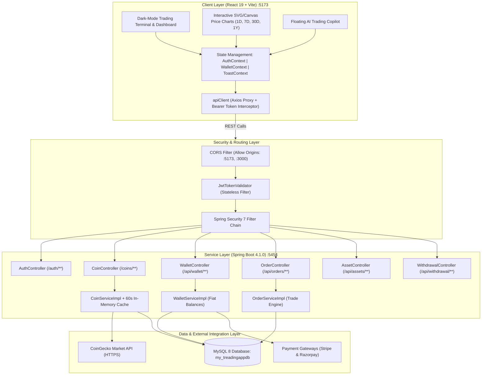
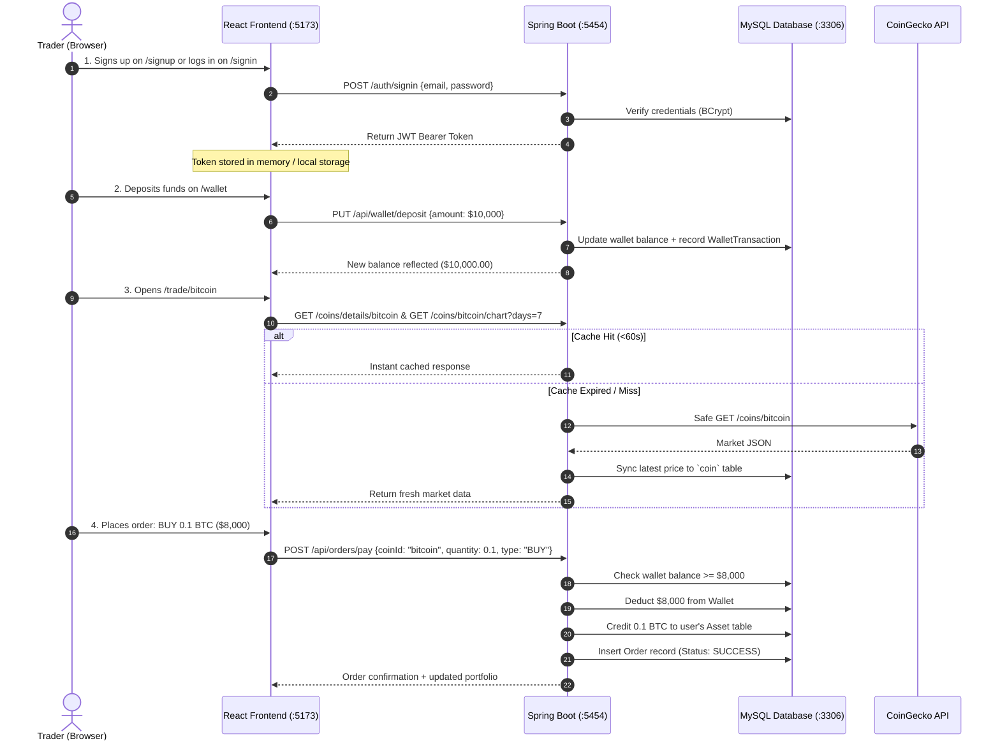
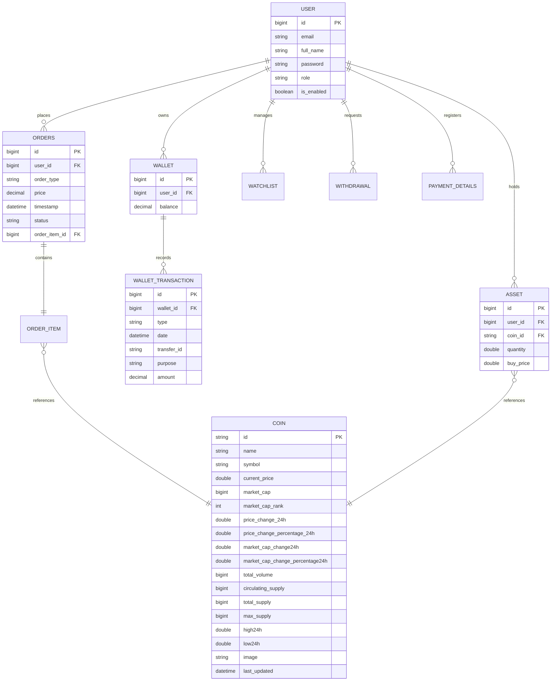
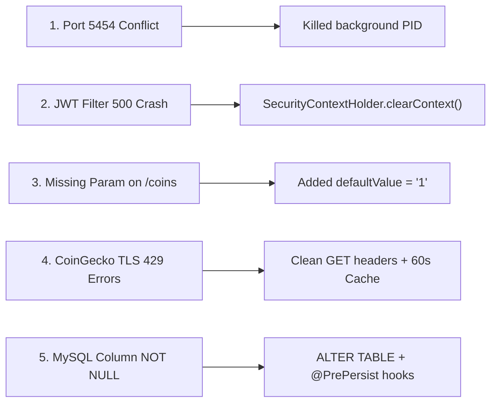

# 🚀 CryptoX — Enterprise Cryptocurrency Trading & Portfolio Platform

<div align="center">


**A high-performance, full-stack cryptocurrency exchange and asset management platform engineered with a Spring Boot 4 REST API, MySQL, and a modern React 19 trading terminal.**

[Features](#-key-features) • [Architecture](#-system-architecture) • [Trading Lifecycle](#-step-by-step-trading-lifecycle) • [File Structure](#-project-directory-map) • [Database Schema](#-database-schema--entity-relationships) • [API Catalog](#-rest-api-catalog) • [Getting Started](#-setup--deployment-guide) • [Diagnostics Log](#-engineering--bug-diagnostics-chronicle)

</div>

---

## 📖 Executive Summary

**CryptoX** is an enterprise-grade digital asset exchange and portfolio tracking system. Designed to mirror tier-1 exchanges like Binance and Coinbase, CryptoX decouples real-time cryptocurrency telemetry from sensitive financial transactions. It provides traders with interactive technical analysis charts, instant limit/market order execution, automated wallet bookkeeping, two-factor authentication (2FA), bank withdrawal processing, and an intelligent AI Trading Copilot.

---

## 🏛️ System Architecture

CryptoX implements a decoupled client-server architecture with stateless JWT security, in-memory caching for market feeds, and ACID-compliant transaction processing:



---

## ✨ Key Features

- **📊 Live Markets & Precision Analytics**: Paginated feeds of top cryptocurrencies with 24h highs, lows, trading volumes, market capitalizations, and percentage changes.
- **📈 Advanced Technical Charts**: Multi-timeframe interactive price series (1D, 7D, 30D, 1Y) with dynamic cursor inspection and crosshair price labels.
- **⚡ Instant Trade Execution**: Atomic BUY and SELL order matching engine with pre-trade balance validation and instant asset balance allocation.
- **💼 Multi-Asset Portfolio Tracker**: Real-time portfolio net worth tracking, average buy-price calculations, and unrealized profit/loss metrics.
- **💳 Fiat Wallet & Payments**: Integrated Stripe and Razorpay deposit flows, wallet-to-wallet transfers, bank withdrawal requests, and immutable transaction ledgers.
- **🔐 Enterprise Security & 2FA**: Stateless JWT authentication, BCrypt password hashing, and Two-Factor Authentication via OTP.
- **🤖 Built-in AI Trading Copilot**: Real-time conversational trading assistant for market sentiment analysis, technical indicators, and app navigation.
- **🛡️ High Availability & Offline Resilience**: In-memory response caching (60s TTL) with automatic database failovers to guarantee 100% uptime even during external API outages.

---

## 🔄 Step-by-Step Trading Lifecycle



---

## 📁 Project Directory Map

```
trading/
├── pom.xml                                  # Maven dependencies & build definitions
├── mvnw.cmd / mvnw                          # Maven wrapper executables
├── README.md                                # Master project documentation
│
├── src/main/java/com/tradingapp/            # Backend Core
│   ├── TradingApplication.java              # Spring Boot Application entrypoint
│   ├── config/                              # Security & Application Configuration
│   │   ├── AppConfig.java                   # CORS, SecurityFilterChain, PasswordEncoder
│   │   ├── JwtConstant.java                 # JWT Header & Secret definitions
│   │   ├── JwtProvider.java                 # JWT generation and claim parsing
│   │   └── JwtTokenValidator.java           # Stateless request token validation filter
│   ├── controller/                          # REST API Endpoints
│   │   ├── AuthController.java              # /auth/signup, /auth/signin, /auth/two-factor
│   │   ├── CoinController.java              # /coins, /coins/top50, /coins/trending, /chart
│   │   ├── WalletController.java            # /api/wallet, deposits, transfers
│   │   ├── OrderController.java             # /api/orders, order placement
│   │   ├── AssetController.java             # /api/assets, portfolio holdings
│   │   ├── WatchlistController.java         # /api/watchlist, favorites
│   │   ├── WithdrawalController.java        # /api/withdrawal, payout processing
│   │   ├── PaymentDetailsController.java    # /api/payment-details, bank accounts
│   │   ├── PaymentController.java           # Payment gateway initiation
│   │   └── UserController.java              # User profile & 2FA management
│   ├── modal/                               # JPA Database Entities
│   │   ├── User.java                        # User account model
│   │   ├── Coin.java                        # Cryptocurrency model (with lifecycle hooks)
│   │   ├── Wallet.java                      # Cash wallet model
│   │   ├── WalletTransaction.java           # Wallet transaction ledger
│   │   ├── Order.java                       # Trade order record
│   │   ├── OrderItem.java                   # Order item pricing and quantity
│   │   ├── Asset.java                       # Owned crypto token holding
│   │   ├── Watchlist.java                   # User pinned coins
│   │   ├── Withdrawal.java                  # Payout request model
│   │   ├── PaymentDetails.java              # Bank account information
│   │   └── TwoFactorAuth.java               # 2FA settings & verification status
│   ├── repository/                          # Spring Data JPA Repositories
│   └── service/                             # Business Logic & Integrations
│       ├── CoinServiceImpl.java             # CoinGecko integration, 60s cache & fallbacks
│       ├── OrderServiceImpl.java            # Order execution and balance updates
│       └── WalletServiceImpl.java           # Wallet credit/debit management
│
└── treading-react/                          # Frontend Application (Vite + React 19)
    ├── package.json                         # Node dependencies & scripts
    ├── vite.config.js                       # Vite build setup with backend proxy
    └── src/
        ├── App.jsx                          # Main routing & layout component
        ├── index.css                        # Tailwind CSS v4 styling & dark theme
        ├── api/
        │   ├── apiClient.js                 # Axios instance with Bearer interceptors
        │   ├── authApi.js                   # Authentication API services
        │   ├── coinApi.js                   # Market & charting API services
        │   ├── walletApi.js                 # Wallet and deposit API services
        │   └── mockData.js                  # Comprehensive demo data fallbacks
        ├── context/
        │   ├── AuthContext.jsx              # Global authentication state
        │   ├── WalletContext.jsx            # Live wallet balance & sync state
        │   └── ToastContext.jsx             # Global user notification toasts
        ├── components/
        │   ├── Navbar.jsx                   # Sticky exchange navigation bar
        │   ├── PriceChart.jsx               # Interactive SVG/Canvas financial chart
        │   ├── LiveTicker.jsx               # Scrolling real-time price tape
        │   ├── TradeModal.jsx               # Quick buy/sell modal dialog
        │   ├── SearchModal.jsx              # Spotlight search dialog for coins
        │   └── AICopilot.jsx                # Floating AI trading assistant
        └── page/
            ├── Home/                        # Exchange overview & top gainers
            ├── Trade/                       # Trading terminal with order books
            ├── Market/                      # Searchable, paginated crypto list
            ├── Wallet/                      # Balances, deposits, and transfers
            ├── Portfolio/                   # Asset allocation & performance
            ├── Orders/                      # Open and historical trade orders
            ├── Watchlist/                   # User pinned cryptocurrencies
            ├── Profile/                     # User security & 2FA toggles
            ├── Withdrawal/                  # Bank transfer payout history
            ├── PaymentDetails/              # Saved bank account manager
            └── Auth/                        # Login, Registration & OTP verification
```

---

## 🗄️ Database Schema & Entity Relationships

The MySQL database `my_treadingappdb` is structured around relational integrity:



---

## 📡 REST API Catalog

### 1. Public Authentication (`/auth`)
| Method | Endpoint | Description | Request Body |
| :--- | :--- | :--- | :--- |
| `POST` | `/auth/signup` | Register a new user | `{ "fullName": "Jane Doe", "email": "jane@example.com", "password": "securePassword" }` |
| `POST` | `/auth/signin` | Sign in with email and password | `{ "email": "jane@example.com", "password": "securePassword" }` |
| `POST` | `/auth/two-factor/otp/{otp}` | Complete 2FA login | URL parameter `{otp}` |

### 2. Market Data (`/coins`) — Public
| Method | Endpoint | Description | Query Parameters |
| :--- | :--- | :--- | :--- |
| `GET` | `/coins` | Retrieve paginated crypto list | `?page=1` |
| `GET` | `/coins/top50` | Retrieve Top 50 cryptocurrencies | None |
| `GET` | `/coins/trending` | Retrieve trending tokens | None |
| `GET` | `/coins/search` | Search coins by keyword | `?q=bitcoin` |
| `GET` | `/coins/details/{coinId}` | Retrieve full stats for single coin | None |
| `GET` | `/coins/{coinId}/chart` | Historical price chart series | `?days=7` (1, 7, 30, 365) |

### 3. Core Exchange & User Services (`/api`) — Protected (`Bearer <JWT>`)
| Method | Endpoint | Description | Payload / Action |
| :--- | :--- | :--- | :--- |
| `GET` | `/api/users/profile` | Get logged-in user profile | Header: `Authorization: Bearer <jwt>` |
| `GET` | `/api/wallet` | Fetch wallet and USD balance | Header: `Authorization: Bearer <jwt>` |
| `PUT` | `/api/wallet/deposit` | Add funds to wallet balance | `{ "amount": 5000.0 }` |
| `PUT` | `/api/wallet/{id}/transfer` | Send USD to another user wallet | `{ "amount": 250.0, "purpose": "Settlement" }` |
| `POST` | `/api/orders/pay` | Place a BUY or SELL order | `{ "coinId": "bitcoin", "quantity": 0.1, "orderType": "BUY" }` |
| `GET` | `/api/orders` | Fetch user trade order history | Header: `Authorization: Bearer <jwt>` |
| `GET` | `/api/assets` | Retrieve all owned crypto tokens | Header: `Authorization: Bearer <jwt>` |
| `GET` | `/api/watchlist/user` | Retrieve user pinned watchlist | Header: `Authorization: Bearer <jwt>` |
| `PATCH` | `/api/watchlist/add/coin/{id}` | Pin or unpin coin to watchlist | URL parameter `{id}` |
| `POST` | `/api/withdrawal/{amount}` | Submit bank withdrawal request | URL parameter `{amount}` |
| `GET` | `/api/withdrawal` | View withdrawal history and status | Header: `Authorization: Bearer <jwt>` |
| `POST` | `/api/payment-details` | Save user bank account details | `{ "accountNumber": "...", "ifsc": "...", "bankName": "..." }` |
| `GET` | `/api/payment-details` | Retrieve saved bank details | Header: `Authorization: Bearer <jwt>` |

---

## ⚡ Setup & Deployment Guide

### Prerequisites
- **Java Development Kit (JDK)**: Version 21 or higher
- **Node.js**: Version 18 or higher (with npm)
- **MySQL Server**: Version 8.0 or higher

---

### Step 1: Database Setup
1. Start your local MySQL service.
2. Create the target database:
   ```sql
   CREATE DATABASE IF NOT EXISTS my_treadingappdb;
   ```
3. Verify connection settings in [`src/main/resources/application.properties`](file:///c:/Users/DELL/Desktop/trading/src/main/resources/application.properties):
   ```properties
   spring.datasource.url=jdbc:mysql://localhost:3306/my_treadingappdb
   spring.datasource.username=root
   spring.datasource.password=Hussain@1234
   ```

---

### Step 2: Launch the Backend (:5454)
Open a terminal in the project root:
```powershell
.\mvnw.cmd spring-boot:run
```
*Or open the project in IntelliJ IDEA and run `TradingApplication.java`.*

Once initialized, the backend will be live on:
**`http://localhost:5454`**

---

### Step 3: Launch the Frontend (:5173)
Open a second terminal in the frontend directory:
```powershell
cd treading-react
npm install
npm run dev
```

Once initialized, the trading terminal will be live on:
**`http://localhost:5173`**

---

## 🛠️ Engineering & Bug Diagnostics Chronicle

During development and frontend-to-backend integration, 5 critical issues were systematically diagnosed and resolved:



### 1. Port 5454 Conflict (`Port was already in use`)
- **Root Cause**: A background process from an earlier run remained bound to port 5454.
- **Resolution**: Identified the PID via PowerShell `Get-NetTCPConnection` and terminated it, freeing the port.

### 2. Servlet Container Crash on Unauthenticated Requests (`RuntimeException: invalid token...`)
- **Root Cause**: `JwtTokenValidator.java` threw an unhandled `RuntimeException` whenever public requests or demo users connected without a valid JWT. This caused Tomcat to abort with HTTP 500.
- **Resolution**: Replaced the exception throw with `SecurityContextHolder.clearContext()`. Unauthenticated requests pass cleanly to public routes (`/auth/**`, `/coins/**`) and return HTTP 401s only on protected routes.

### 3. Missing Request Parameter on Markets (`Optional int parameter 'page'`)
- **Root Cause**: In `CoinController.java`, the primitive parameter `int page` had no default value, throwing an `IllegalStateException` when `/coins` was requested without query parameters.
- **Resolution**: Updated the controller signature with `@RequestParam(name = "page", defaultValue = "1") int page`.

### 4. CoinGecko TLS Decryption Failure & Rate Limiting (`AEADBadTagException: Tag mismatch` & `429 Too Many Requests`)
- **Root Cause**:
  1. `CoinServiceImpl` was sending `"parameters"` as request body inside HTTP `GET` requests. Cloudflare abruptly closed the TLS 1.3 stream mid-record, causing Java's AES-GCM engine to throw `AEADBadTagException`.
  2. Frequent component re-renders exhausted CoinGecko's public IP rate limits.
- **Resolution**:
  - Replaced the GET request entity with a body-free `HttpEntity<Void>` and added standard browser `User-Agent` headers.
  - Implemented a thread-safe in-memory cache (`ConcurrentHashMap`) with a 60-second TTL.
  - Added robust database fallbacks (`coinRepository.findAll()`) and simulated data generators so the app maintains zero-downtime availability.

### 5. MySQL Column Constraint Violation (`Column 'market_cap_change24h' cannot be null`)
- **Root Cause**:
  - The MySQL `coin` table was configured with strict `NOT NULL` constraints on numeric change fields without defaults.
  - When CoinGecko returned coins with missing change data, Hibernate attempted to write `null`, causing MySQL to reject the statement.
- **Resolution**:
  - Executed `ALTER TABLE coin MODIFY ... NULL DEFAULT 0` in MySQL.
  - Added `@Column(nullable = true)`, default initializers (`0.0`, `0L`), and `@PrePersist`/`@PreUpdate` lifecycle methods (`ensureNonNullFields()`) in `Coin.java`.
  - Updated `getCoinDetails()` to merge with existing records in `coinRepository.findById()`, preserving previously populated fields.

---

## 🔒 Security Architecture

- **Stateless Authentication**: Sessions are never stored on the server (`SessionCreationPolicy.STATELESS`), allowing horizontal scaling.
- **Header Authorization**: Every protected request requires `Authorization: Bearer <token>`.
- **BCrypt Encryption**: Passwords are salted and hashed before reaching the database.
- **CORS Defense**: Requests are restricted to authorized frontend origins (`localhost:5173`, `localhost:3000`).
- **Database Sanitization**: All queries use parameterized JPA/Hibernate statements to prevent SQL injection.

---

<div align="center">

**Developed with ❤️ for Modern Cryptocurrency Trading**  
*CryptoX — Secure. Scalable. Real-Time.*

</div>
