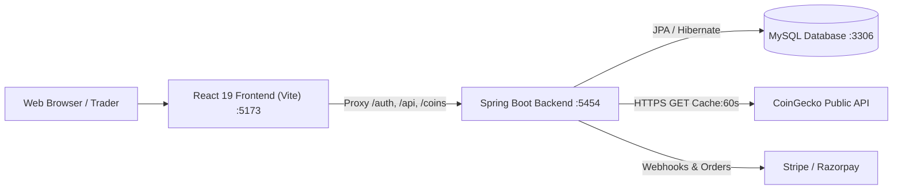

# 🚀 CryptoX - Full-Stack Cryptocurrency Trading Platform

A modern, full-featured cryptocurrency trading application with a **Spring Boot 4 / Java 21 REST API** backend and a **React 19 / Vite / Tailwind CSS** frontend.

---

## 📑 Table of Contents
1. [Architecture Overview](#-architecture-overview)
2. [Tech Stack](#-tech-stack)
3. [Key Features](#-key-features)
4. [Backend API Documentation](#-backend-api-documentation)
5. [Database Schema](#-database-schema)
6. [Frontend Application Structure](#-frontend-application-structure)
7. [Installation & Setup](#-installation--setup)
8. [Troubleshooting & Bug Fixes Log](#-troubleshooting--bug-fixes-log)

---

## 🏛️ Architecture Overview



---

## 💻 Tech Stack

### Backend
- **Framework**: Spring Boot 4.1.0
- **Language**: Java 21
- **Security**: Spring Security 7 with Stateless JWT (`Bearer Token`)
- **Database & ORM**: MySQL 8 with Spring Data JPA / Hibernate
- **JSON & Data Binding**: Jackson 3 (`tools.jackson`)
- **Payment Processing**: Stripe API & Razorpay SDK
- **External Data**: CoinGecko API with in-memory caching and failover fallback

### Frontend
- **Framework**: React 19
- **Build Tool**: Vite
- **Styling**: Tailwind CSS v4 (Modern Dark Exchange Theme)
- **Icons**: Lucide React
- **HTTP Client**: Axios with interceptors and base routing
- **State Management**: React Context (`AuthContext`, `WalletContext`, `ToastContext`)

---

## ✨ Key Features

### 1. Market Data & Interactive Charts
- Real-time cryptocurrency prices, 24h high/low, volume, market cap, and percentage changes.
- Interactive SVG/Canvas price charts supporting 1-day, 7-day, 30-day, and 1-year historical trends.
- In-memory 60-second caching layer to prevent CoinGecko `429 Too Many Requests` rate limiting.
- Graceful database and mock fallbacks ensuring the interface never crashes.

### 2. Trading Terminal
- Instant **BUY** and **SELL** order placement.
- Real-time balance validation before order processing.
- Asset portfolio synchronization upon order execution.
- Order history tracking with status filters (Pending, Completed, Cancelled).

### 3. Wallet & Payment Gateways
- Multi-currency fiat balance (USD).
- Deposit funds via **Stripe** or **Razorpay**.
- Wallet-to-wallet balance transfers.
- Withdrawal requests with status tracking (Pending, Success, Declined).
- Bank account management (IFSC, Account Number, Bank Name).

### 4. User Security & Authentication
- Secure User Registration and Login with BCrypt password hashing.
- Stateless JSON Web Token (JWT) authorization header verification.
- Two-Factor Authentication (2FA) via OTP (Email/SMS).
- Password recovery and reset tokens.

### 5. AI Copilot
- Built-in floating AI Trading Assistant offering market sentiment analysis, technical indicators, and quick navigation.

---

## 📡 Backend API Documentation

### Authentication (`/auth`)
| Method | Endpoint | Description | Public / Protected |
| :--- | :--- | :--- | :--- |
| `POST` | `/auth/signup` | Register a new user | Public |
| `POST` | `/auth/signin` | Login with email and password | Public |
| `POST` | `/auth/two-factor/otp/{otp}` | Verify 2FA OTP for login | Public |

### Coins & Markets (`/coins`)
| Method | Endpoint | Description | Public / Protected |
| :--- | :--- | :--- | :--- |
| `GET` | `/coins` | Get paginated coins list (`?page=1`) | Public |
| `GET` | `/coins/top50` | Get Top 50 cryptocurrencies | Public |
| `GET` | `/coins/trending` | Get trending coins | Public |
| `GET` | `/coins/search?q={query}` | Search coins by keyword | Public |
| `GET` | `/coins/details/{coinId}` | Get single coin details & market data | Public |
| `GET` | `/coins/{coinId}/chart?days={days}` | Historical price chart series | Public |

### Wallet & Orders (`/api`)
| Method | Endpoint | Description | Protected |
| :--- | :--- | :--- | :--- |
| `GET` | `/api/wallet` | Get authenticated user wallet & balance | Yes (JWT) |
| `PUT` | `/api/wallet/deposit` | Deposit funds into wallet | Yes (JWT) |
| `PUT` | `/api/wallet/{walletId}/transfer` | Transfer funds to another wallet | Yes (JWT) |
| `POST` | `/api/orders/pay` | Place a BUY or SELL order | Yes (JWT) |
| `GET` | `/api/orders` | Get user order history | Yes (JWT) |
| `GET` | `/api/assets` | Get user owned crypto holdings | Yes (JWT) |
| `GET` | `/api/watchlist/user` | Get user watchlist | Yes (JWT) |
| `PATCH` | `/api/watchlist/add/coin/{coinId}` | Add/remove coin from watchlist | Yes (JWT) |
| `POST` | `/api/withdrawal/{amount}` | Request a withdrawal | Yes (JWT) |
| `GET` | `/api/withdrawal` | Get user withdrawal history | Yes (JWT) |
| `POST` | `/api/payment-details` | Save bank account details | Yes (JWT) |
| `GET` | `/api/payment-details` | Retrieve saved bank details | Yes (JWT) |
| `GET` | `/api/users/profile` | Get current user profile | Yes (JWT) |

---

## 🗄️ Database Schema

The application uses MySQL with the database `my_treadingappdb`:

1. **`user`**: `id`, `email`, `full_name`, `password`, `role`, `is_enabled`, `send_to`
2. **`coin`**: `id`, `name`, `symbol`, `current_price`, `market_cap`, `market_cap_rank`, `price_change_24h`, `price_change_percentage_24h`, `market_cap_change24h`, `market_cap_change_percentage24h`, `total_volume`, `circulating_supply`, `total_supply`, `max_supply`, `ath`, `atl`, `image`, `last_updated`
3. **`wallet`**: `id`, `balance`, `user_id`
4. **`wallet_transaction`**: `id`, `wallet_id`, `type`, `date`, `transfer_id`, `purpose`, `amount`
5. **`orders`**: `id`, `user_id`, `order_type`, `price`, `timestamp`, `status`, `order_item_id`
6. **`order_item`**: `id`, `quantity`, `buy_price`, `sell_price`, `coin_id`
7. **`asset`**: `id`, `quantity`, `buy_price`, `coin_id`, `user_id`
8. **`watchlist`**: `id`, `user_id`
9. **`withdrawal`**: `id`, `user_id`, `amount`, `status`, `date`
10. **`payment_details`**: `id`, `user_id`, `account_number`, `account_holder_name`, `ifsc`, `bank_name`

---

## ⚡ Installation & Setup

### Prerequisites
- Java JDK 21+
- Node.js 18+ & npm
- MySQL Server 8.0+

### Step 1: Configure MySQL Database
Create database `my_treadingappdb` in MySQL:
```sql
CREATE DATABASE IF NOT EXISTS my_treadingappdb;
```
Verify `src/main/resources/application.properties`:
```properties
spring.datasource.url=jdbc:mysql://localhost:3306/my_treadingappdb
spring.datasource.username=root
spring.datasource.password=Hussain@1234
```

### Step 2: Run Backend
In project root:
```powershell
.\mvnw.cmd spring-boot:run
```
Backend will start on: `http://localhost:5454`

### Step 3: Run Frontend
Open a new terminal:
```powershell
cd treading-react
npm install
npm run dev
```
Frontend will start on: `http://localhost:5173`

---

## 🛠️ Troubleshooting & Bug Fixes Log

During the development and integration phases, several key challenges were diagnosed and resolved:

### 1. Port 5454 Conflict (`Port was already in use`)
- **Cause**: A background Java process remained running from a previous launch.
- **Fix**: Freed port 5454 by terminating the background process.

### 2. JWT Filter Container Crash (`RuntimeException: invalid token...`)
- **Cause**: `JwtTokenValidator.java` threw an unhandled `RuntimeException` whenever public requests or demo tokens passed through without a valid JWT.
- **Fix**: Replaced exception throwing with `SecurityContextHolder.clearContext()`, allowing public endpoints to proceed normally and protected endpoints to respond with standard HTTP 401s.

### 3. Coin Controller Null Parameter (`Optional int parameter 'page'`)
- **Cause**: `CoinController.getCoinList(int page)` did not specify a default value, failing when `/coins` was called without `?page=X`.
- **Fix**: Added `defaultValue = "1"` to `@RequestParam`.

### 4. CoinGecko 429 Rate Limits & TLS Aborts (`AEADBadTagException: Tag mismatch`)
- **Cause**: Outgoing HTTP GET requests sent `"parameters"` as request body, violating HTTP GET standards and causing Cloudflare to terminate the TLS 1.3 connection. Additionally, repeated calls hit CoinGecko's rate limits.
- **Fix**: Removed the GET body (`HttpEntity<Void>`), added standard `User-Agent` headers, introduced a 60-second in-memory response cache, and established fallback to local database and simulated data.

### 5. MySQL Null Constraint (`Column 'market_cap_change24h' cannot be null`)
- **Cause**: In MySQL, `coin` table columns had strict `NOT NULL` constraints. When CoinGecko returned coins with missing change data, updates failed.
- **Fix**: Executed `ALTER TABLE coin MODIFY ... NULL DEFAULT 0` in MySQL, added default values with `@PrePersist`/`@PreUpdate` in `Coin.java`, and merged existing database records before saving in `CoinServiceImpl.java`.
