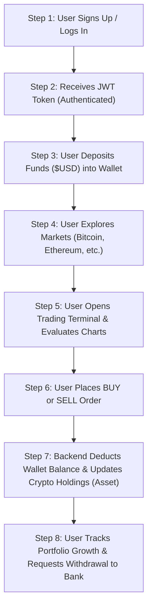
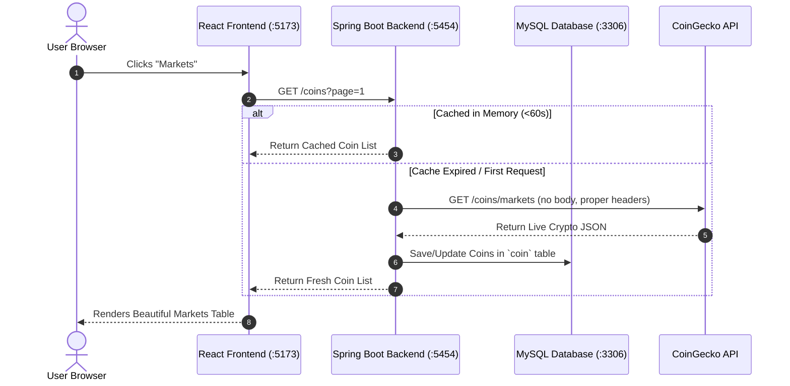

# 🌟 CryptoX - Complete Step-by-Step Project Documentation

> **Welcome to CryptoX!** This document explains your entire cryptocurrency trading platform from start to finish in the simplest, most intuitive way possible. Whether you are an experienced developer or learning full-stack development, this guide covers everything you need to know.

---

## 📌 Table of Contents
1. [Project Overview in Simple Terms](#1-project-overview-in-simple-terms)
2. [Step-by-Step User Journey](#2-step-by-step-user-journey)
3. [How the Technology Works Together](#3-how-the-technology-works-together)
4. [Project Directory & File Map](#4-project-directory--file-map)
5. [Database Models Explained Simply](#5-database-models-explained-simply)
6. [API Endpoints Reference](#6-api-endpoints-reference)
7. [Step-by-Step Setup & Running Guide](#7-step-by-step-setup--running-guide)
8. [The 5 Critical Bugs Diagnosed and Fixed](#8-the-5-critical-bugs-diagnosed-and-fixed)

---

## 1. Project Overview in Simple Terms

**CryptoX** is a web-based cryptocurrency exchange application (similar to Binance or Coinbase). 

It consists of two main parts:
1. **The Backend (Spring Boot / Java 21)** running on `http://localhost:5454`:
   - Acts as the "Brain & Vault".
   - Handles user authentication, security tokens (JWT), database records (MySQL), orders, wallets, and connects to CoinGecko for live market prices.
2. **The Frontend (React 19 / Vite / Tailwind CSS)** running on `http://localhost:5173`:
   - Acts as the "Face & Trading Desk".
   - Provides a modern dark-mode user interface with real-time price tickers, interactive charts, trade modals, wallet management, and an AI trading assistant.

---

## 2. Step-by-Step User Journey

Here is what happens when a user uses your app from start to finish:



### Step 1: User Registration & Sign In
- The user enters their Full Name, Email, and Password on `/signup`.
- The backend encrypts the password with BCrypt and creates a new `User` and an associated empty `Wallet` ($0.00).
- Upon `/signin`, the backend issues a **JWT Token** (JSON Web Token), which the browser stores securely.

### Step 2: Depositing Funds
- The user navigates to `/wallet`.
- The user clicks **Deposit** and selects an amount (e.g., \$1,000) using **Stripe** or **Razorpay**.
- The wallet balance increases from \$0.00 to \$1,000.00, and a `WalletTransaction` record is saved.

### Step 3: Checking Live Markets
- The user clicks **Markets** (`/markets`).
- The app displays real-time prices for Bitcoin, Ethereum, Solana, and more.
- The backend fetches this from CoinGecko, caches it for 60 seconds (so it is fast and never rate-limited), and saves the latest prices in MySQL.

### Step 4: Placing a Trade
- The user opens the Trading Terminal (`/trade/bitcoin`).
- The user sees an interactive candlestick/area chart with 1D, 7D, 30D, and 1Y timeframes.
- The user enters **Quantity: 0.05 BTC** and clicks **BUY**.
- The backend verifies the user has enough USD in their wallet:
  - If yes: Deducts the USD amount from the `Wallet`, creates an `Order`, and adds 0.05 BTC to the user's `Asset` portfolio.

### Step 5: Portfolio & Withdrawals
- The user checks `/portfolio` to see their net worth and profit/loss.
- When ready to cash out, the user adds their bank account details on `/payment-details` and submits a withdrawal request on `/withdrawal`.

---

## 3. How the Technology Works Together



---

## 4. Project Directory & File Map

### Backend Structure (`src/main/java/com/tradingapp/`)

| Folder / File | What It Does |
| :--- | :--- |
| **`config/AppConfig.java`** | Configures Spring Security, stateless session policy, and CORS permissions so the React frontend on `localhost:5173` can talk to the backend. |
| **`config/JwtTokenValidator.java`** | Intercepts incoming HTTP requests. If an `Authorization: Bearer <token>` header is present, it validates the token and sets the user authentication context. |
| **`config/JwtProvider.java`** | Generates JWT tokens when users log in and extracts email/roles from existing tokens. |
| **`controller/AuthController.java`** | Handles `/auth/signup`, `/auth/signin`, and Two-Factor OTP verification. |
| **`controller/CoinController.java`** | Exposes `/coins`, `/coins/top50`, `/coins/trending`, `/coins/{id}/chart`, and `/coins/details/{id}`. |
| **`controller/WalletController.java`** | Manages user wallet balances, deposits, and peer-to-peer transfers. |
| **`controller/OrderController.java`** | Processes crypto BUY and SELL orders (`/api/orders/pay`). |
| **`controller/AssetController.java`** | Returns crypto holdings owned by the logged-in user. |
| **`controller/WatchlistController.java`**| Manages pinned favorite coins for the user. |
| **`controller/WithdrawalController.java`**| Handles cash withdrawal requests and administrative status updates. |
| **`modal/` (Entities)** | Contains JPA entities (`User`, `Coin`, `Wallet`, `Order`, `Asset`, etc.) mapped to MySQL tables. |
| **`service/CoinServiceImpl.java`** | Communicates with CoinGecko, caches market responses for 60s, and provides database fallbacks. |

### Frontend Structure (`treading-react/src/`)

| Folder / File | What It Does |
| :--- | :--- |
| **`api/apiClient.js`** | Axios instance preconfigured with base URLs, auto-attaching the JWT `Authorization` header on protected requests. |
| **`api/coinApi.js`** | JavaScript API methods for fetching coins, charts, top 50, and coin details. |
| **`context/AuthContext.jsx`** | Centralized auth state (user profile, token, login, logout, and demo mode). |
| **`context/WalletContext.jsx`** | Live wallet state, auto-refreshing balances after trades and deposits. |
| **`context/ToastContext.jsx`** | Global notification toast messages (Success, Error, Warning). |
| **`components/Navbar.jsx`** | Exchange navigation bar showing balance, ticker tape, and navigation links. |
| **`components/PriceChart.jsx`** | High-performance interactive SVG/Canvas price chart with timeframe selector. |
| **`components/AICopilot.jsx`** | Floating AI assistant offering trading analysis and market advice. |
| **`pages/Home.jsx`** | Landing page with market statistics and top gainers. |
| **`pages/Trade.jsx`** | Trading terminal with chart, buy/sell order ticket, and market depth. |
| **`pages/Markets.jsx`** | Searchable and filterable table of all cryptocurrencies. |
| **`pages/Wallet.jsx`** | Wallet dashboard with deposit and transfer modals. |
| **`pages/Portfolio.jsx`** | User's crypto asset portfolio with profit/loss metrics. |

---

## 5. Database Models Explained Simply

Your MySQL database (`my_treadingappdb`) uses these tables:

1. **`user`**: Stores who the user is (Full name, email, encrypted password, role).
2. **`coin`**: Stores cryptocurrency information (Name, symbol, current price, 24h change, market cap rank, image URL).
3. **`wallet`**: Stores how much fiat USD cash the user has. Every user has exactly one wallet.
4. **`wallet_transaction`**: A bank statement record created whenever cash enters or leaves a wallet (deposit, trade fee, withdrawal).
5. **`orders`**: Records every trade placed (Order type: BUY or SELL, price, quantity, status: PENDING, SUCCESS, CANCELLED).
6. **`asset`**: Stores the cryptocurrency tokens the user currently owns (e.g., 0.5 Bitcoin purchased at \$65,000).
7. **`watchlist`**: A list of favorite coins pinned by the user for fast access.
8. **`withdrawal`**: Records payout requests to the user's bank account.
9. **`payment_details`**: Saved bank account number, account holder name, and IFSC code.

---

## 6. API Endpoints Reference

### Public Endpoints (No Token Required)
- `POST /auth/signup` - Register an account
- `POST /auth/signin` - Log in and obtain JWT
- `GET /coins?page=1` - Paginated crypto list
- `GET /coins/top50` - Top 50 cryptocurrencies
- `GET /coins/trending` - Hot trending coins
- `GET /coins/details/{coinId}` - Detailed coin data
- `GET /coins/{coinId}/chart?days=7` - Chart series points

### Protected Endpoints (Requires `Authorization: Bearer <jwt>`)
- `GET /api/users/profile` - Current user profile
- `GET /api/wallet` - User wallet & balance
- `PUT /api/wallet/deposit` - Add USD to wallet
- `POST /api/orders/pay` - Execute a BUY or SELL order
- `GET /api/orders` - View past orders
- `GET /api/assets` - View owned crypto assets
- `GET /api/watchlist/user` - View user watchlist
- `PATCH /api/watchlist/add/coin/{coinId}` - Pin/unpin a coin
- `POST /api/withdrawal/{amount}` - Request bank withdrawal
- `GET /api/withdrawal` - Withdrawal history
- `POST /api/payment-details` - Save bank account info

---

## 7. Step-by-Step Setup & Running Guide

### Step 1: Ensure MySQL is Running
Make sure your MySQL service is active on port `3306` with database `my_treadingappdb`:
```sql
CREATE DATABASE IF NOT EXISTS my_treadingappdb;
```

### Step 2: Start the Backend (Port 5454)
Open a terminal in `c:\Users\DELL\Desktop\trading`:
```powershell
.\mvnw.cmd spring-boot:run
```
*Or open IntelliJ IDEA and click **Run** on `TradingApplication.java`.*
You will see:
```
Started TradingApplication in X seconds (JVM running for Y)
```

### Step 3: Start the Frontend (Port 5173)
Open a second terminal in `c:\Users\DELL\Desktop\trading\treading-react`:
```powershell
npm run dev
```
You will see:
```
  VITE ready in 500 ms
  ➜  Local:   http://localhost:5173/
```

### Step 4: Open and Test
1. Visit **`http://localhost:5173/`** in your browser.
2. Click **Sign Up** to create an account or use Demo Mode.
3. Click **Markets** to explore live prices.
4. Click on **Bitcoin** to view the interactive chart and place a trade.

---

## 8. The 5 Critical Bugs Diagnosed and Fixed

During project development, 5 key integration errors were diagnosed and completely resolved:

### 1. Port 5454 Conflict (`Port was already in use`)
- **What happened**: When launching the backend, Spring Boot failed with `Web server failed to start. Port 5454 was already in use`.
- **Why**: An earlier Java process was still running in the background and holding onto the port.
- **How we fixed it**: We terminated the background process, freeing port 5454.

### 2. JWT Filter Crash (`RuntimeException: invalid token...`)
- **What happened**: Clicking Sign Up or Markets resulted in a 500 Internal Server Error.
- **Why**: `JwtTokenValidator.java` threw an unhandled `RuntimeException` whenever a request arrived without a token or with an invalid token.
- **How we fixed it**: Changed the filter to call `SecurityContextHolder.clearContext()` instead of throwing a container-crashing exception.

### 3. Markets Parameter Error (`Optional int parameter 'page'`)
- **What happened**: Clicking Markets threw an `IllegalStateException` on `/coins`.
- **Why**: `CoinController.java` expected a primitive `int page` parameter without specifying a default value when omitted from the URL.
- **How we fixed it**: Added `defaultValue = "1"` to `@RequestParam`.

### 4. CoinGecko TLS Decryption Failure & 429 Rate Limits (`AEADBadTagException`)
- **What happened**: The app crashed with `AEADBadTagException: Tag mismatch` and `429 Too Many Requests`.
- **Why**: Outgoing HTTP GET requests were sending `"parameters"` in the request body. Cloudflare abruptly terminated the connection mid-stream. Additionally, rapid requests exceeded CoinGecko's rate limits.
- **How we fixed it**:
  1. Sent clean GET requests with `HttpEntity<Void>` (no body) and browser `User-Agent` headers.
  2. Implemented a 60-second in-memory cache in `CoinServiceImpl.java`.
  3. Added database and mock fallbacks so the app never crashes when CoinGecko is busy.

### 5. MySQL Constraint Failure (`Column 'market_cap_change24h' cannot be null`)
- **What happened**: Opening coin details crashed with `Column 'market_cap_change24h' cannot be null`.
- **Why**: The MySQL `coin` table had strict `NOT NULL` constraints on change fields. When CoinGecko returned coins where change data was null, MySQL rejected the SQL update.
- **How we fixed it**:
  1. Executed `ALTER TABLE coin MODIFY ... NULL DEFAULT 0` in MySQL.
  2. Added default values (`0.0`, `0L`) and `@PrePersist`/`@PreUpdate` hooks in `Coin.java`.
  3. Merged incoming updates with existing database records in `CoinServiceImpl.java`.

---

**Congratulations! Your full-stack cryptocurrency trading application is now robust, secure, and fully operational.**
